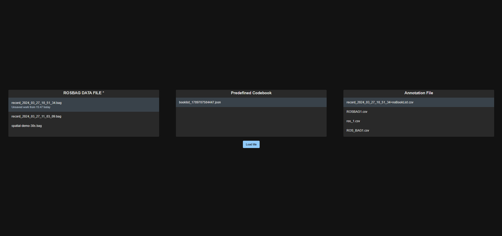
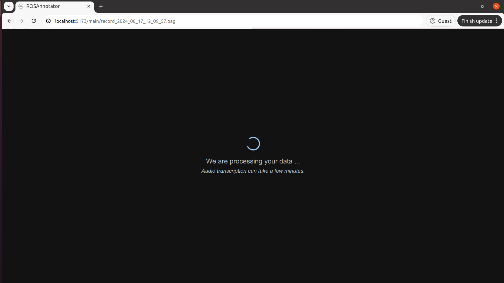
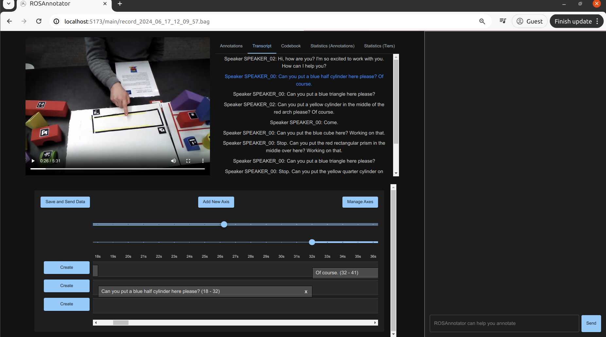
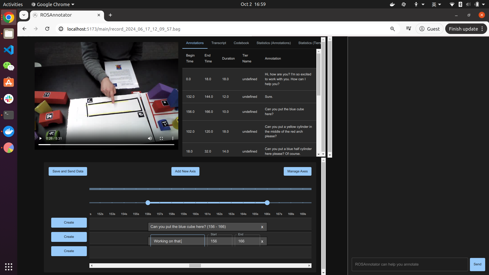
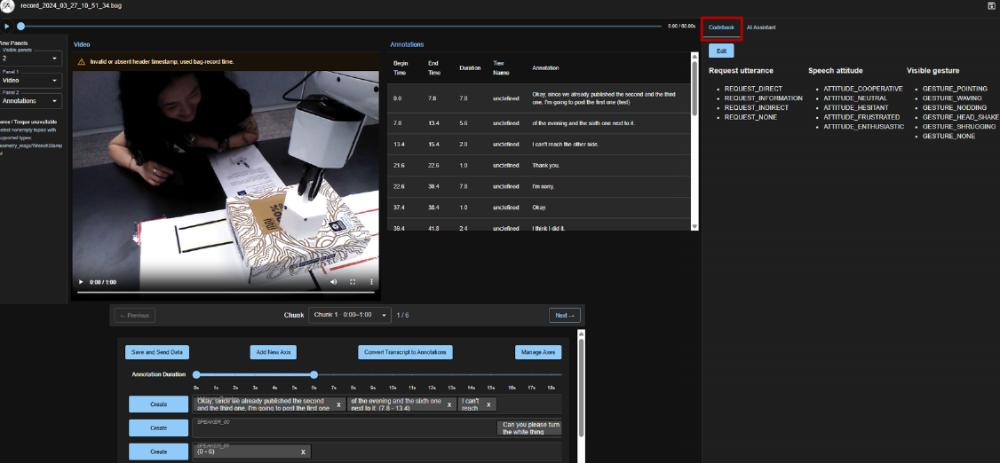
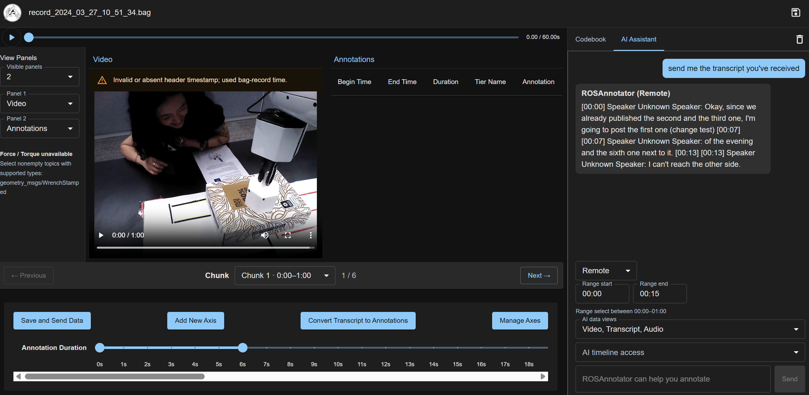

# ROSAnnotator
## Project Overview
ROSAnnotator is a web-based application that incorporates a Vision-Language Model (VLM) to support both manual and automated annotation of ROSBag data. The application is envisioned to be a versatile tool for researchers, enabling the loading of multiple ROSBags and the provision of a synchronized, interactive dashboard for intuitive data visualization. ROSAnnotator currently facilitates video, audio, and transcription annotations and provides an open interface for custom ROS messages and tools.

## Architecture

See the [design diagram](docs/design-diagram.md) and
[data-view processing contracts](docs/data-view-processing-contracts.md).

## Repository Structure

The ROSAnnotator project integrates ROS (Robot Operating System) with Django to process and annotate ROSBag files. The project also includes a React-based frontend for interacting with the annotations and managing data.

```
├── .github/         # GitHub configuration and workflows
├── data-samples/    # Sample data for testing
├── src/             # Source code for the project
│   ├── backend/    # Backend (Django) application code
│   │   ├── asgi.py # ASGI config
│   │   ├── wsgi.py # WSGI config
│   │   ├── urls.py # URL routing
│   │   ├── rosbag_processing/  # ROSBag processing code
│   │   │   ├── views.py        # API endpoints related to ROSBag
│   │   │   └── data_utils.py   # Data utilities related to ROSBag
│   │   ├── Dockerfile          # Dockerfile for backend
│   │   └── requirements.txt    # Python dependencies
│   └── frontend/   # Frontend (React) application code
│       ├── components/  # Reusable React components
│       └── pages/       # Page components for different routes
├── docker-compse.yml # Docker Compose config
└── datas/            # Will be created after building the Docker image
    ├── rosbag-data/ # Place your ROSBag data here
    ├── booklist/    # Place your predefined codebook here
    ├── annotation/  # Retrieve your annotation output here
    └── processed/   # Store all the processed data, e.g. extracted videos and transcriptions

```

## Installation and Set up

1. **General System Requirements**

   Minimum requirement: A laptop with at least a dual-core processor, 4GB of RAM, a 64-bit operating system, 25GB of available storage, and the capability to run Docker and a modern web browser.

   The code has been tested by this combination: Ubuntu 20.04 LTS, ROS Noetic, Python 3.9, Chrome version:130.0.6723.117.
   
2. **Clone the Repository**

   Clone this repository and enter its root directory:

   ```bash
   git clone <repository-url>
   cd ROSAnnotator-Group6
   ```

3. **Prerequisite — Docker Installation**

   - Before you begin, ensure that you have Docker installed on your machine. If not, download and install Docker from [Docker's official site](https://www.docker.com/get-started).
   - Verify that the **Docker daemon** is running by executing `docker info` in your terminal. This should return information about the Docker client and server. If not, please start the Docker daemon.

3. **Configure Environment Variables**

   Create `.env` in the **repository root**, next to `docker-compose.yml`:

   ```dotenv
   OPENAI_API_KEY=your_openai_api_key
   HUGGINGFACE_AUTH_TOKEN=your_huggingface_read_token
   ```

   Do not commit this file. For gated Pyannote models, the Hugging Face account
   associated with the token must have accepted the model terms.

4. **Download a example Local AI Model**

   Before starting Docker, create the local model directory and download **one**
   of the following model options. Model files are intentionally excluded from
   Git because they are large, so every new clone needs this step.

   **Example A — Qwen (text only)**

   Use Qwen based on text files (e.g. request-utterance and speech-attitude annotation based on transcript). It does not
   accept video frames and therefore cannot perform actions such as gesture annotation.

   ```bash
   mkdir -p models
   curl -L --fail --progress-bar \
     -o models/qwen2.5-0.5b-instruct-q4_k_m.gguf \
     https://huggingface.co/Qwen/Qwen2.5-0.5B-Instruct-GGUF/resolve/main/qwen2.5-0.5b-instruct-q4_k_m.gguf
   ```

   **Example B — SmolVLM2 (text and visual input)**

   Use SmolVLM2 when annotation from video frames is required (e.g. gesture annotation). This
   option needs both the model and its multimodal projector.

   ```bash
   mkdir -p models
   curl -L --fail --progress-bar \
     -o models/SmolVLM2-500M-Video-Instruct-Q8_0.gguf \
     https://huggingface.co/ggml-org/SmolVLM2-500M-Video-Instruct-GGUF/resolve/main/SmolVLM2-500M-Video-Instruct-Q8_0.gguf
   curl -L --fail --progress-bar \
     -o models/mmproj-SmolVLM2-500M-Video-Instruct-f16.gguf \
     https://huggingface.co/ggml-org/SmolVLM2-500M-Video-Instruct-GGUF/resolve/main/mmproj-SmolVLM2-500M-Video-Instruct-f16.gguf
   ```

   Confirm that the selected files were downloaded successfully:

   ```bash
   ls -lh models/
   ```

5. **Select the Local AI Model**

   Copy the example configuration before the first run:

   ```bash
   cp .env.example .env
   ```

   Set `LOCAL_AI_MODEL` in the root `.env` file to the downloaded model's
   filename **without** the `.gguf` suffix. This is the single configuration
   point used by both llama.cpp and the backend.

   For Qwen:

   ```dotenv
   LOCAL_AI_MODEL=qwen2.5-0.5b-instruct-q4_k_m
   ```

   For SmolVLM2:

   ```dotenv
   LOCAL_AI_MODEL=SmolVLM2-500M-Video-Instruct-Q8_0
   ```

   The startup script automatically loads SmolVLM2's multimodal projector.
   You do not include the projector filename in `.env`.

   To override `.env` for one run, put the selection before the Docker command:

   ```bash
   LOCAL_AI_MODEL=SmolVLM2-500M-Video-Instruct-Q8_0 docker compose up --build
   ```

   **additional steps on windows**:
   ```powershell
   $path = Resolve-Path .\scripts\start-local-llm.sh
   $content = [IO.File]::ReadAllText($path).Replace("`r`n", "`n")
   [IO.File]::WriteAllText($path, $content, [Text.UTF8Encoding]::new($false))
   ```
6. **Starting the Server**

   Run the following commands in the root directory of the project:

   ```bash
   docker compose up --build -d
   docker compose ps
   ```

   > _Note: The total image size is about 20 GB, so it may take a while for the first time to download and build the image. The speed depends on your computational resources and internet connection._

   Open <http://localhost:5173/> after both services report `Up`. To follow the
   application logs:

   ```bash
   docker compose logs -f
   ```

   To stop the containers:

   ```bash
   docker compose down
   ```

   To start the existing containers again:

   ```bash
   docker compose up -d
   ```

   The `datas` folder is created automatically. If it is owned by root on
   Linux, assign it to the current user:

   ```bash
   sudo chown -R "$(id -u):$(id -g)" datas
   ```

7. **Environment**

    The application requires OpenAI API Key (ChatGPT) and Hugging Face Access Token. Before running it in docker, please create a .env file in the root path of **backend** and manually place two variables, **OPENAI_API_KEY** and **HUGGINGFACE_AUTH_TOKEN**, inside. Please restart the container after changing the .env file.

8. **Access the Application**

   Both the front end and the back end are hosted locally in a Docker container. Once the server is up and running, you can access the [web app](http://localhost:5173/) at `http://localhost:5173/`.

9. **Sample Data**

   We provided a sample ROSBag and a sample codebook in the folder `/data-samples`. The codebook needs to be in JSON format and put in the `/datas/booklist` folder. Please put the .bag file in the `/datas/rosbag-data` folder.

10. **Adding your own data**
    Put files in the correct folder.

    ```
    ├──  datas/        # Will be created after building the Docker image
        ├── rosbag-data/ # Place your ROSBag data here
        ├── booklist/    # Place your predefined codebook here
        ├── annotation/  # Retrieve your annotation output here
        └── processed/   # Store all the processed data, e.g. extracted videos and transcriptions
    ```

    Select your bag files, codebook (optional), and annotation file (if you need to retrieve your work) on the import page.

   

   The transcription may take several minutes, depending on the audio length.

   **Windows Docker workaround:** After each chunk finishes processing for the
   first time, restart the frontend so Docker can see the generated video:

   ```bash
   docker compose restart frontend
   ```
   
   

   **Customised Data**

   The topics for video and audio data must be configured to match the corresponding topics in the ROSBag. In the sample ROSBag, the topic for video is `/xtion/rgb/image_raw_throttled`, and the topic for audio is `/audio`. Topic names can be modified in the `/src/backend/rosbag_processing/data_utils.py` file. If additional message types need to be extracted, they should also be defined within this file.

   For any custom tools, users should add the necessary functions in the `/src/backend/rosbag_processing/views.py` file. If users wish to customize prompts for the vision language model (VLM), they can modify them in the same file.

---

## Usage Guide

[Overview Video](https://www.youtube.com/watch?v=cCD-JclDxLM)

1. **Import Data**
    all rosbag data, booklist and annotations added to the datas/ folder will be available for selection in the data loading page.
    **Note**: reload might be needed when opening localhost the first time after the service is up. 

    Select your bag files, codebook (optional), and annotation file (if you need to retrieve your work) on the import page.

   

   The transcription may take several minutes, depending on the audio length.

   **Windows Docker workaround:** After each chunk finishes processing for the
   first time, restart the frontend so Docker can see the generated video:

   ```bash
   docker compose restart frontend
   ```
   
   
   

2. **Manual Annotation**

   The transcription and codebook will appear at the top of the annotation page. Loading a transcript does not automatically create annotation axes or blocks. Saved annotations can still be loaded, and new annotations can be created manually. When splitting an input into chunks, speaker labels may refer to different people across chunks; check speaker identities before combining annotations.

   Click `Convert Transcript to Annotations` to create one axis per speaker with the transcript text and timestamps for the current timeline. Empty type-in axes with matching names are reused, including speaker axes saved in another chunk. Matching axes that already contain annotations, have another type, or have duplicate names are skipped to preserve existing work. The result message reports any skipped speakers or invalid timestamps. The button is available once transcript speaker segments have loaded.

   In the Transcript panel, click `Edit transcript` to correct speaker labels, text, and start/end times, or add and remove segments. `Rename all matching segments` changes a speaker label throughout the current transcript. Click `Save transcript` to persist corrections for the current input and chunk; they are restored when the same processed transcript is loaded again. Corrections are stored separately from the generated transcript in `transcript.edits.json` in its processed-view directory, so keep that directory when preserving your work. Saved corrections update the transcript display, AI context, and future annotation conversion. Existing annotation blocks are not rewritten. Cancel discards unsaved edits; a failed save keeps the draft open for retry.

   

   

   Click `Add new axis` to create a new annotation tier. In `Manage Axes`, users can change the name and type of the time axis. There are two types: `type-in` allows users to type any codes as annotation; `select` allows users to choose one code from the codebook via a drop-down list.

   In the annotation area, users can double-click to create a block for annotation. By clicking the block, users can edit the code, change the time interval, or delete it.

   There are two blue dots on the top of the time axis, which users can drag to mark a specific time, then click the `create` button on the left side of one of the time axis to create an annotation.

   In the toolbar panel, there is an `annotation` function. Users can see the summary of all the annotations in a table.

   

   Users can edit the pre-defined codebook from the toolbar. By clicking `save`, the codebook JSON file will be updated.

      

3. **AI-assisted Auto Annotation**

   Users can provide instructions in the chatbox, and the VLM can provide help after several minutes of processing. Instruction examples are:
   
   > Can you annotate all the request utterances made by participants in a new time axis?
   > 
   > Can you annotate the participant's attitudes in speech according to the codebook in a new time axis?
   > 
   > Can you annotate the participant's gestures in the video according to the codebook in a new time axis?

   The VLM's annotation is not always correct. Users can edit the annotation manually.

   Completed AI runs are saved in `/datas/annotation` as
   `ai_records_<rosbag-file-name>+<booklist-file-name>_<manifest-id>.json`
   (using `noBookList` when no booklist is selected). Each run is added to the
   existing file for that manifest, so processing the same input and chunk
   again preserves earlier runs. Records for different chunks in the same
   manifest are distinguished by `chunk_index`. Runs without a manifest keep
   the older filename format without the manifest ID.

    

4. **Statistic Summary**
   
    In addition to different data-views available, in the toolbar panel, there are two statistic summary functions. Users can check both the summary of all annotations and the summary of annotations in different tiers.

5. **Save Data**

    **It is very important to click "Save and Send Data" before exiting ROSAnnotator.** The saved file will be in the `/datas/annotation` folder in CSV format so that users can retrieve their process by loading that file next time.

    **autosave note**: progress are auto-saved locally, in response for unexpected webapp quit. Autosaved does not write to the exported annotation file, and will be automatically detected upon entering the webapp with unsaved

6. **Others**

   The transcription will be saved in `/datas/processed`. Users can generate the annotation for transcription again by deleting that file.

---

## Maintenance

We are dedicated to maintaining this project by addressing bugs, refining functionality, and keeping the documentation up to date. We encourage users to fork the repository for custom development and welcome contributions through pull requests, which we will review thoughtfully and collaboratively.

### Manual deployment from GHCR

Merging a pull request into `main` publishes frontend and backend images tagged
with the full merge commit SHA. Deployment to a customer-managed server is
currently manual; no workflow connects to or modifies the target server.

The target Linux server needs Docker Engine and Docker Compose. A GPU deployment
also needs a compatible NVIDIA driver and NVIDIA Container Toolkit. Create a
deployment directory containing `.env` and `docker-compose.prod.yml`.

Use the SHA of the exact `main` commit that was tested and approved:

```dotenv
RELEASE_SHA=0eb993440d93a28cd49de4417765846cc5d70416
OPENAI_API_KEY=your_openai_api_key
HUGGINGFACE_AUTH_TOKEN=your_huggingface_read_token
```

Do not commit this file. Create `docker-compose.prod.yml` as follows:

```yaml
services:
  backend:
    image: ghcr.io/samw314/hri-sim-group6-backend:sha-${RELEASE_SHA}
    env_file:
      - .env
    gpus: all
    restart: unless-stopped
    ports:
      - "8000:8000"
    volumes:
      - ./datas/rosbag-data:/app/datas/rosbag-data
      - ./datas/booklist:/app/datas/booklist
      - ./datas/annotation:/app/datas/annotation
      - ./datas/processed:/app/processed_data

  frontend:
    image: ghcr.io/samw314/hri-sim-group6-frontend:sha-${RELEASE_SHA}
    restart: unless-stopped
    ports:
      - "5173:5173"
    volumes:
      - ./datas/processed:/app/public/processed
    depends_on:
      - backend
```

If the application packages are private, authenticate with a classic personal
access token that has only `read:packages` access:

```bash
docker login ghcr.io
```

Pull and start the pinned release:

```bash
mkdir -p datas/rosbag-data datas/booklist datas/annotation datas/processed
docker compose --env-file .env -f docker-compose.prod.yml pull
docker compose --env-file .env -f docker-compose.prod.yml up -d
docker compose --env-file .env -f docker-compose.prod.yml ps
docker compose --env-file .env -f docker-compose.prod.yml logs -f
```

To deploy an update, replace `RELEASE_SHA` with the new tested `main` commit SHA
and run `pull` followed by `up -d` again. To roll back, restore the previous SHA
and run the same two commands. Never deploy an unqualified or moving tag when a
commit-SHA tag is available.

> **Current production limitation:** the frontend source calls
> `http://localhost:8000` directly, and both images run development servers
> (`npm start` and Django `runserver`). A browser on another computer interprets
> `localhost` as that computer, not the deployment server. Before exposing this
> deployment to customers, configure a deployable API base URL or reverse proxy,
> serve the built frontend with a production web server, run Django through a
> production WSGI server, and enable HTTPS. The Compose example above is suitable
> for controlled validation on the server or through local port forwarding, not
> yet for an Internet-facing production service.

### Backend container images

The backend container is split into two images so the GitHub-hosted CI runner
does not reinstall the large ROS, CUDA, PyTorch, Whisper, and Pyannote runtime
for every change:

- `src/backend/Dockerfile.base` builds the GPU/ROS dependency image.
- `src/backend/Dockerfile` adds only the Django application code.

The normal `docker compose up --build` command downloads the base image pinned
in `src/backend/Dockerfile`; it does not reinstall `requirements.txt`. Rebuild
and publish the base image whenever `requirements.txt`, `Dockerfile.base`, or
`env_config/` changes:

```bash
docker buildx build \
  --platform linux/amd64 \
  --file src/backend/Dockerfile.base \
  --tag ghcr.io/kihara001/hri-sim-group6-backend-base:gpu-v1 \
  --push \
  src/backend

docker buildx imagetools inspect \
  ghcr.io/kihara001/hri-sim-group6-backend-base:gpu-v1
```

Copy the resulting `sha256:...` digest into `BACKEND_BASE_IMAGE` in
`src/backend/Dockerfile` and the matching base-image references in
`.github/workflows/build-validation.yml`. Pinning the digest ensures local and
CI builds use exactly the same dependency image.

The currently tested audio-model dependency set is:

```text
huggingface_hub==0.24.6
speechbrain==1.0.0
torch==2.5.1
torchaudio==2.5.1
torchvision==0.20.1
pyannote.audio==3.4.0
```

The base package must remain public so pull request workflows can read it
without exposing registry credentials. Pull requests build both application
images without publishing them. After a pull request is merged, the `main`
workflow publishes commit-SHA-tagged frontend and backend application images
to GHCR.

## Citation

ROSAnnotator has been used in the following papers: (coming soon)

If you use our code or paper in your work, please cite the following:

```

```

## License

This repository is licensed under the MIT License with a [Commons Clause](https://commonsclause.com).
