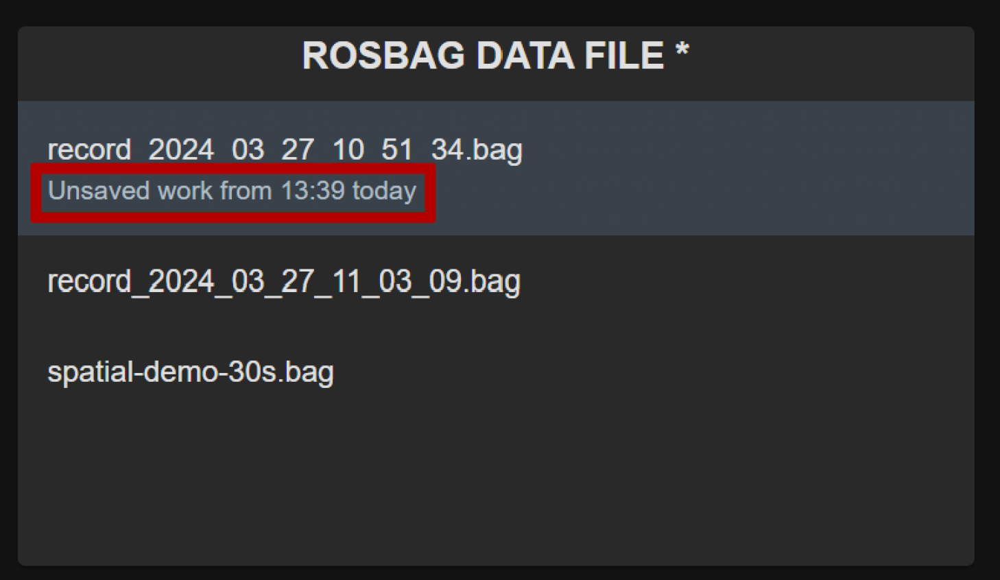
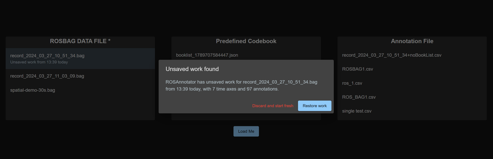
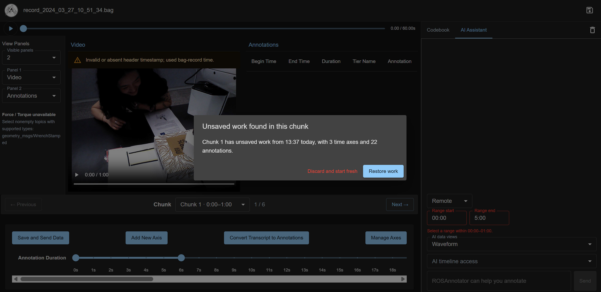
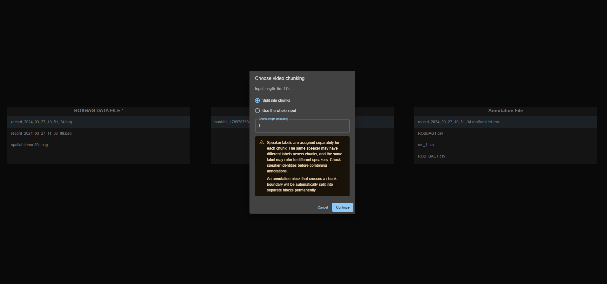
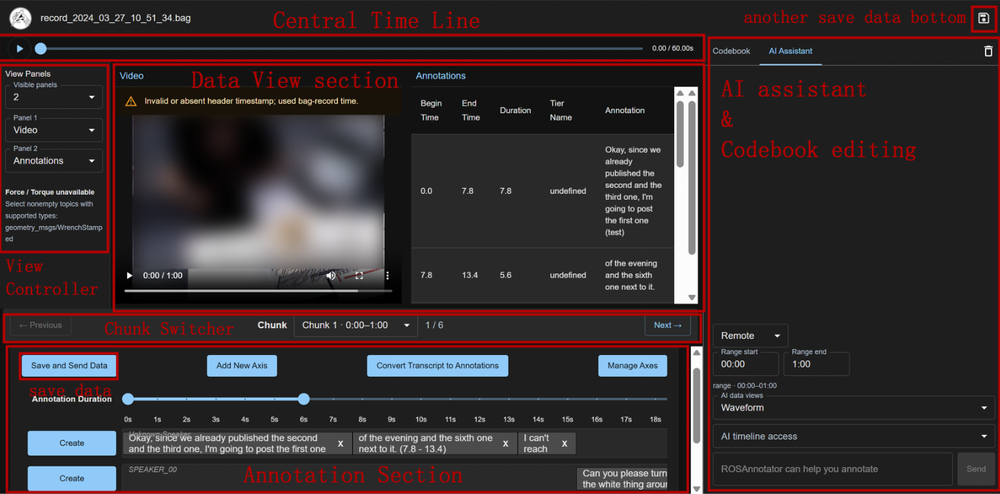
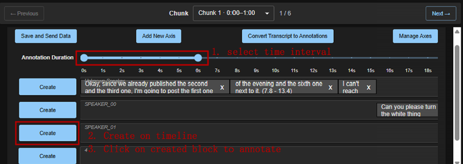
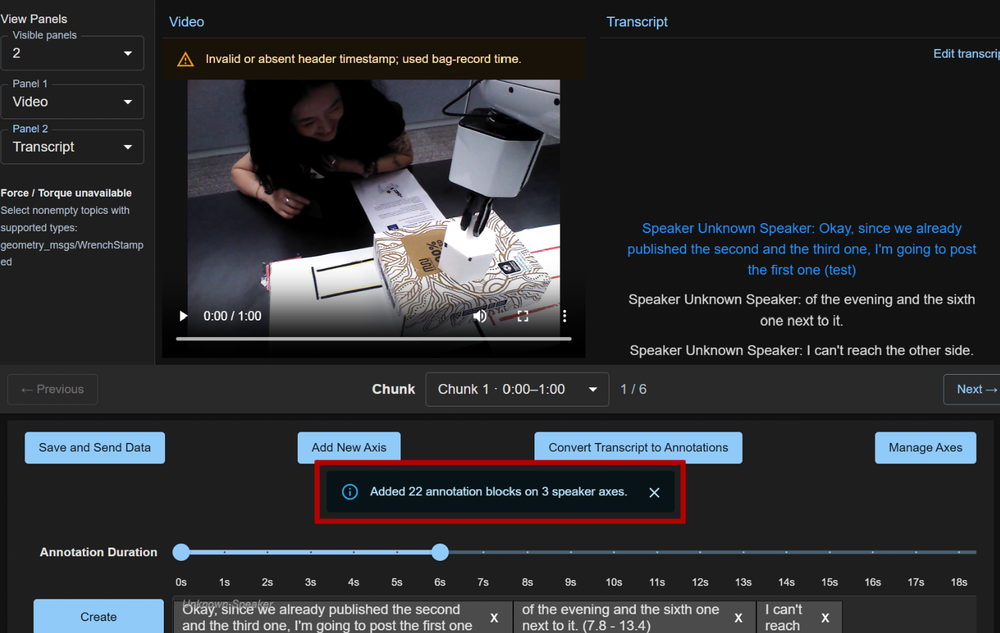
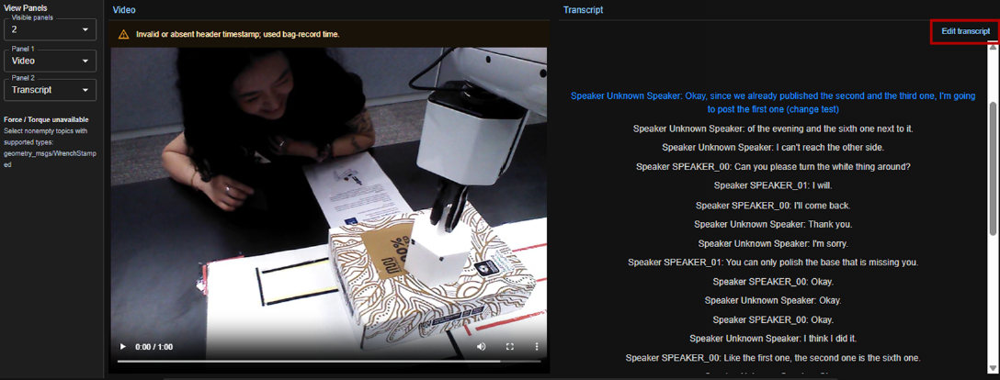
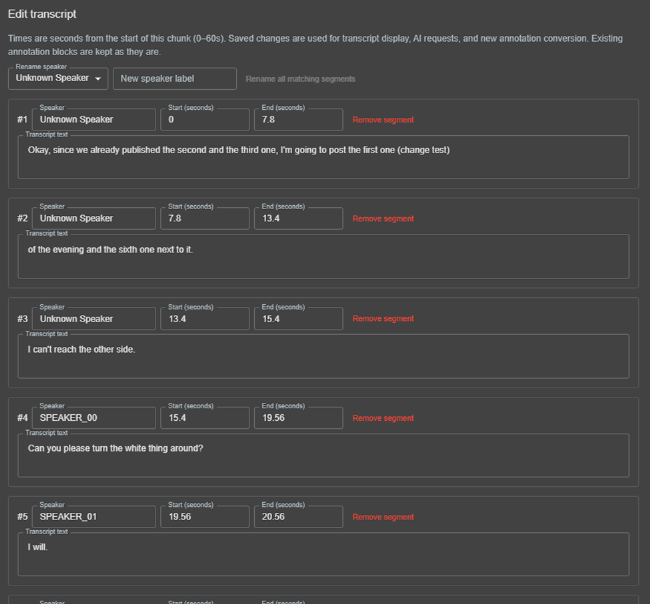

# ROSAnnotator
## Project Overview
ROSAnnotator is a web-based application that incorporates remote and local language-model assistants, including vision-capable models, to support both manual and automated annotation of ROSBag data. Researchers can select one ROSBag per session from the available files and inspect its synchronized data views in an interactive dashboard. ROSAnnotator currently supports video, audio, waveform, transcript, annotation, statistics, and force/torque views and provides processor interfaces for adding support for further ROS message types.

## Architecture

See the [design diagram](docs/design-diagram.md) and
[data-view processing contracts](docs/data-view-processing-contracts.md).

## Repository Structure

The ROSAnnotator project integrates ROS (Robot Operating System) with Django to process and annotate ROSBag files. The project also includes a React-based frontend for interacting with the annotations and managing data.

```
├── .github/workflows/       # GitHub Actions build and publication workflow
├── docs/                    # Design, data-view, saving, and style documentation
├── models/                  # Local model files (excluded from Git)
├── scripts/                 # Local model startup scripts
├── src/
│   ├── backend/             # Django backend
│   │   ├── ros_annotator/   # Django settings, URLs, ASGI, and WSGI configuration
│   │   ├── rosbag_processing/ # ROSBag APIs, processors, caching, and annotation logic
│   │   ├── tests/           # Backend test modules
│   │   ├── Dockerfile       # Backend application image
│   │   ├── Dockerfile.base  # ROS/ML dependency base image
│   │   └── requirements.txt # Python dependencies
│   └── frontend/            # React/Vite frontend
│       ├── src/             # Components, pages, API helpers, and types
│       ├── tests/           # Frontend test modules
│       ├── Dockerfile       # Frontend image
│       └── package.json     # Frontend dependencies and scripts
├── docker-compose.yml       # Local service configuration
└── datas/                   # Runtime data bind-mounted by Docker Compose
    ├── rosbag-data/         # ROSBag inputs
    ├── booklist/            # Codebook JSON files
    ├── annotation/          # Annotation exports, AI records, and recovery data
    └── processed/           # Generated media, transcripts, manifests, and view caches

```

## Installation and Set up

1. **General System Requirements**

   Minimum requirement: A laptop with at least a dual-core processor, 4GB of RAM, a 64-bit operating system, 25GB of available storage, and the capability to run Docker and a modern web browser.

   The code has been tested by this combination: Ubuntu 20.04 LTS, ROS Noetic, Python 3.9, Chrome version:130.0.6723.117.
   
2. **Clone the Repository**

   Clone this repository and enter its root directory:

   ```bash
   git clone <repository-url>
   cd ROSAnnotator-Group6
   ```

3. **Prerequisite — Docker Installation**

   - Before you begin, ensure that you have Docker installed on your machine. If not, download and install Docker from [Docker's official site](https://www.docker.com/get-started).
   - Verify that the **Docker daemon** is running by executing `docker info` in your terminal. This should return information about the Docker client and server. If not, please start the Docker daemon.

4. **Configure Environment Variables**

   Create `.env` in the **repository root**, next to `docker-compose.yml`, as per our `.env.example` file:

   ```bash
   cp .env.example .env
   ```

   Do not commit this file. For gated Pyannote models, the Hugging Face account
   associated with the token must have accepted the model terms.

5. **Setting remote AI**
The application requires OpenAI API Key (ChatGPT) and Hugging Face Access Token. Before running it in docker, please set the corresponding .env variable:

* **OPENAI_API_KEY** and **HUGGINGFACE_AUTH_TOKEN**.

Please restart the container after changing the .env file.

6. **Download a example Local AI Model**

   Before starting Docker, create the local model directory and download **one**
   of the following model options. Model files are intentionally excluded from
   Git because they are large, so every new clone needs this step.

   **Example A — Qwen (text only)**

   Use Qwen based on text files (e.g. request-utterance and speech-attitude annotation based on transcript). It does not
   accept video frames and therefore cannot perform actions such as gesture annotation.

   ```bash
   mkdir -p models
   curl -L --fail --progress-bar \
     -o models/qwen2.5-0.5b-instruct-q4_k_m.gguf \
     https://huggingface.co/Qwen/Qwen2.5-0.5B-Instruct-GGUF/resolve/main/qwen2.5-0.5b-instruct-q4_k_m.gguf
   ```

   **Example B — SmolVLM2 (text and visual input)**

   Use SmolVLM2 when annotation from video frames is required (e.g. gesture annotation). This
   option needs both the model and its multimodal projector.

   ```bash
   mkdir -p models
   curl -L --fail --progress-bar \
     -o models/SmolVLM2-500M-Video-Instruct-Q8_0.gguf \
     https://huggingface.co/ggml-org/SmolVLM2-500M-Video-Instruct-GGUF/resolve/main/SmolVLM2-500M-Video-Instruct-Q8_0.gguf
   curl -L --fail --progress-bar \
     -o models/mmproj-SmolVLM2-500M-Video-Instruct-f16.gguf \
     https://huggingface.co/ggml-org/SmolVLM2-500M-Video-Instruct-GGUF/resolve/main/mmproj-SmolVLM2-500M-Video-Instruct-f16.gguf
   ```

   Confirm that the selected files were downloaded successfully:

   ```bash
   ls -lh models/
   ```

7. **Select the Local AI Model**
   Set `LOCAL_AI_MODEL` in the root `.env` file to the downloaded model's
   filename **without** the `.gguf` suffix. This is the single configuration
   point used by both llama.cpp and the backend.

   For Qwen:

   ```dotenv
   LOCAL_AI_MODEL=qwen2.5-0.5b-instruct-q4_k_m
   ```

   For SmolVLM2:

   ```dotenv
   LOCAL_AI_MODEL=SmolVLM2-500M-Video-Instruct-Q8_0
   ```

   The startup script automatically loads SmolVLM2's multimodal projector.
   You do not include the projector filename in `.env`.

   To override `.env` for one run, put the selection before the Docker command:

   ```bash
   LOCAL_AI_MODEL=SmolVLM2-500M-Video-Instruct-Q8_0 docker compose up --build
   ```

   **additional steps on windows**:
   ```powershell
   $path = Resolve-Path .\scripts\start-local-llm.sh
   $content = [IO.File]::ReadAllText($path).Replace("`r`n", "`n")
   [IO.File]::WriteAllText($path, $content, [Text.UTF8Encoding]::new($false))
   ```

8. **Starting the Server**

   Run the following commands in the root directory of the project for first-time setup:

   ```bash
   docker compose up --build -d
   docker compose ps
   ```

   > _Note: For first-time setup and ordinary frontend or backend source-code changes,
   `docker compose up --build -d` rebuilds the application images, but it does not rebuild `src/backend/Dockerfile.base`; the backend continues to use the dependency base pinned in `src/backend/Dockerfile`.
   If you changed `requirements.txt`, `Dockerfile.base`, or `env_config/`,
   follow the [local dependency workflow](#testing-or-applying-dependency-changes-locally)
   instead. That workflow rebuilds the dependency base locally, overrides the
   default pin, and starts the resulting images without publishing anything._

   > _Note: The total image size is about 20 GB, so it may take a while for the first time to download and build the image. The speed depends on your computational resources and internet connection._

   Open <http://localhost:5173/> after all services report `Up`. To follow the
   application logs:

   ```bash
   docker compose logs -f
   ```

   To stop the containers:

   ```bash
   docker compose down
   ```

   To start the existing containers again:

   ```bash
   docker compose up -d
   ```

   The `datas` folder is created automatically. If it is owned by root on
   Linux, assign it to the current user:

   ```bash
   sudo chown -R "$(id -u):$(id -g)" datas
   ```

9. **Access the Application**

   Both the front end and the back end are hosted locally in a Docker container. Once the server is up and running, you can access the [web app](http://localhost:5173/) at `http://localhost:5173/`.

10. **Sample Data**

   We provided a sample ROSBag and a sample codebook in the folder `/data-samples`. The codebook needs to be in JSON format and put in the `/datas/booklist` folder. Please put the .bag file in the `/datas/rosbag-data` folder.

11. **Adding your own data**
    Put files in the correct folder.

    ```
    ├──  datas/        # Will be created after building the Docker image
        ├── rosbag-data/ # Place your ROSBag data here
        ├── booklist/    # Place your predefined codebook here
        ├── annotation/  # Retrieve your annotation output here
        └── processed/   # Store all the processed data, e.g. extracted videos and transcriptions
    ```

    Select your bag files, codebook (optional), and annotation file (if you need to retrieve your work) on the import page.

   **Customised Data**

   The topics for video and audio data must be configured to match the corresponding topics in the ROSBag. In the sample ROSBag, the topic for video is `/xtion/rgb/image_raw_throttled`, and the topic for audio is `/audio`. Topic names can be modified in the `/src/backend/rosbag_processing/data_utils.py` file. If additional message types need to be extracted, they should also be defined within this file.

   For any custom tools, users should add the necessary functions in the `/src/backend/rosbag_processing/views.py` file. If users wish to customize prompts for the vision language model (VLM), they can modify them in the same file.

---

## Usage Guide

[Overview Video](https://www.youtube.com/watch?v=cCD-JclDxLM)

0. **Import Data**
    all rosbag data, booklist and annotations added to the datas/ folder will be available for selection in the data loading page.
    **Note**: reload might be needed when opening localhost the first time after the service is up. 

    Select your bag files, codebook (optional), and annotation file (if you need to retrieve your work) on the import page.

   

   **Windows Docker workaround:** After each chunk finishes processing for the
   first time, restart the frontend so Docker can see the generated video:

   ```bash
   docker compose restart frontend
   ```

1. **Unsaved work recovery**
   User's working history is automatically saved in autosave files at the background. RosAnnotator detect unsaved work history when trying to load a particular piece of data, and prompt user if they want to resume previous work, or start fresh.

   > _Note: the tempary autosave file is NOT intended to be equivalent to the manually saved annotation files. They are only temparary, and can't be selected as a loaded annotation file.

   > _Note: if user choose to resume previous work, then their selected annotation file will NOT be imported for the relevant section, to avoid conflict between resumed work and imported annotations.
   
   **whole-input working history**
   When a RosBag file is loaded as-a-whole, it carries a single file-based autosave file. Unsaved work will be detected at the data-import page, with a notification that shows up when the corresponding RosBag file is clicked:

     

   After user click the [load me] button, a prompt will show up to ask the user if they want to resume the unsaved work or start fresh. the prompt will provide information about the amound of annotation exist in the unsaved work.

   

   From this point, if user select resume work, they will entering their unsaved working session (without loading any new annotation to avoid conflict, even if an annotation file is selected). If user select to discard, they will enter the chunk-selection prompt in step 2. Note that discarding autosave content is an one-off action that can't be undone.

   **single-chunk working history**
   When a RosBag file is loaded in chunks, each chunk has their individual autosave file. Unsaved work will be detected, upon loading an input with the same chunking setting as a previous session, and entering a chunk with unsaved work:

   

   Work is resumed or discarded by chunk, rather by entire input. Thus, a 5-chunk input might only have it's first 3 chunks carrying unsaved work. Users are free to resume work from certain particular chunk, while start fresh from other chunks. 
   
   When resuming work for a chunk, the selected annotation file will not be imported for that chunk, but can still be used for the rest of the chunk where user decide to discard autosaved work.
   
   >_Note: for more technical details about chunk & annotation saving, refer to the documentation at 

2. **Chunk selection**
   For scalability, RosAnnotator allows user to select between importing the selected RosBag file as a whole, or devided by chunks with a selected length. After clicking "Load Me" at the loading page, a chunk setting selection prompt will come up for user selection:

   

   Before actually starting to load and preprocess the data, user selects between split input in to chunks devided by their specified chunk, or treat it as a whole unified input. After a selection is confirmed, RosAnnotator will start to pre-process the input RosBag file. This may take several minutes, depending on the length and existing datatypes of the input.

   

   **Windows Docker workaround:** After each chunk finishes processing for the
   first time, restart the frontend image so Docker can see the generated video:

   ```bash
   docker compose restart frontend
   ```

   After processing finishes (for the first chunk, if user select to import by chunk), user enters the working page of RosAnnotator.

   

   If user select to import by chunk, a drop-down menu will be available for user to switch between chunks. Annotation work will survive chunk switch even if it's not saved to an annotation file, however, user should still eventually save their work manually.
   
   RosAnnotator preprocess each chunk upon the user entering that chunk for the first time. Afterward, upon second or later visit, it uses the cached preprocessing result to save time and computational power.

   >_Note: When splitting an input into chunks, speaker labels may refer to different people across chunks, as the transcript generation LM can only receive information from the current chunk during each processing session. Check speaker identities before combining annotations.   

3. **Manual Annotation**

   In the annotation area, users can double-click to create a block for annotation. By clicking the block, users can edit the annotation text or change the time interval.

   There are two blue dots on the top of the time axis, which users can drag to mark a specific time, then click the `create` button on the left side of one of the time axis to create an annotation.

   

   

   >_Note: A single timeline axis cannot contain annotation with overlaping time range. For annotations with overlaping time, use multiple timeline axis.

   **Managing annotation axis**

   Click `Add new axis` to create a new annotation tier. In `Manage Axes`, users can change the name and type of the time axis. There are two types: `type-in` allows users to type any codes as annotation; `select` allows users to choose one code from the codebook via a drop-down list.

   **Transcript to annotation**
   The transcription and codebook will appear at the top of the annotation page. Loading a transcript does not automatically create annotation axes or blocks. 

   Click `Convert Transcript to Annotations` to create one axis per speaker with the transcript text as annotation blocks. Empty type-in axes with matching names are reused, including speaker axes saved in another chunk. 
   
   Axes with matching name to a speaker that already contain annotations, have another type, or have duplicate names are skipped to preserve existing work. A message will appear to report any skipped speakers or invalid timestamps. The button is available once transcript speaker segments have loaded.

   

4. **AI-assisted Auto Annotation**

   User can select between a Remote and Local LM for Auto Annotation. User can specify what datatype is being send to the LM, and the timerange of the data type send. User can further specify which timeline axis that the LM are authorised to change.

   Users can provide instructions in the chatbox, and the VLM can provide help after several minutes of processing. Instruction examples are:
   
   > Can you annotate all the request utterances made by participants in a new time axis?
   > 
   > Can you annotate the participant's attitudes in speech according to the codebook in a new time axis?
   > 
   > Can you annotate the participant's gestures in the video according to the codebook in a new time axis?

   The VLM's annotation is not always correct. Users can edit the annotation manually.

   Completed AI run records are saved in `/datas/annotation` as
   `ai_records_<rosbag-file-name>+<booklist-file-name>_<manifest-id>.json`
   (using `noBookList` when no booklist is selected). Each run is added to the
   existing file for that manifest, so processing the same input and chunk
   again preserves earlier runs. Records for different chunks in the same
   manifest are distinguished by `chunk_index`. Runs without a manifest keep
   the older filename format without the manifest ID.

    

   **Using and Editing a codebook**
   During import, user can optionally select a codebook of json format. If a codebook is selected, it can be viewed at the codebook section. This codebook can be edited, and by clicking 'save', any changes will be updated to the loaded JSON file.

   If a codebook is not selected, user can also create codebook inside RosAnnotator by editing on top of an empty codebook and click 'save'. It will generate a json codebook file with automatically generated file name.

      

5. **Transcript Editing**
   In the Transcript viewing panel, click `Edit transcript` to correct speaker labels, text, and start/end times, or add and remove segments. `Rename all matching segments` allows user to changes a speaker label throughout the current transcript. 
   
   Click `Save transcript` to persist corrections for the current input and chunk; they are restored when the same processed transcript is loaded again. Corrections are stored separately from the generated transcript in `transcript.edits.json` in its corresponding sub-directioy of it's processed-view directory to be preserved. Saved corrections update the transcript display, AI context, and future annotation conversion. Existing annotation blocks are not rewritten. Cancel discards unsaved edits; a failed save keeps the draft open for retry.

     

     

6. **Save Data**

    **It is very important to click "Save and Send Data" before exiting ROSAnnotator.** The saved file will be in the `/datas/annotation` folder in CSV format so that users can retrieve their process by loading that file next time.

    When working on an input by chunk, "Save and Send Data" saves annotations at the current chunk only, by adding/replacing the annotation records in the timerange relevant to the current chunk in the annotation file specified by user's entered file name. It does not save works for other chunks, or effect records outside of the current chunk's time range in any other way. (for more technical details about chunk & annotation saving, refer to the documentation at )

    > _**Autosave Note**: progress are auto-saved locally, in response for unexpected webapp quit. Autosave does not write to the exported annotation file, and will be automatically detected upon entering the webapp with unsaved. Those are temporary files that are NOT intended to replace manually saved work

---

## Deployment scope

ROSAnnotator is currently designed, documented, and tested for local deployment
with Docker Compose. Server-oriented deployment, including deployment to
Spartan HPC, is outside the scope of the current project.

GitHub Actions validates container builds for pull requests. Every push to
`main`, including a pull-request merge, publishes frontend and backend images to
GitHub Container Registry using commit-SHA tags. These images provide a
foundation for possible future server deployment, but they have not been
configured or validated as a production or Spartan HPC deployment.

### Backend images: local use and base-image maintenance

The backend runtime is split into a reusable dependency base and a smaller
application layer so local machines and the GitHub-hosted CI runner do not
rebuild the large ROS, CUDA, PyTorch, Whisper, and Pyannote dependency set for
every change:

- `src/backend/Dockerfile.base` builds the GPU/ROS dependency image.
- `src/backend/Dockerfile` starts from that pinned base, installs FFmpeg and a
  compatibility subset of runtime pins, and then copies the Django application
  code.

#### Normal local use

The normal `docker compose up --build` command builds and runs the application
images locally. During the backend build, Docker pulls the dependency base
image pinned in `src/backend/Dockerfile` if it is not already available. This
command does not build `src/backend/Dockerfile.base` or publish an image.

Because the complete Python dependency installation is part of the reusable
base image, a normal application-image build does not rerun the complete
`requirements.txt`. An uncached application-image build still installs FFmpeg
and the compatibility pins declared in `src/backend/Dockerfile`.

##### Testing or applying dependency changes locally

If you change `requirements.txt`, `Dockerfile.base`, or `env_config/`, rebuild
the dependency base locally instead of using the previously pinned image. Then
build the backend with `BACKEND_BASE_IMAGE` pointing to that local image:

```bash
# 1. Rebuild the dependency base from the local requirements.txt,
# Dockerfile.base, and env_config/. The local tag gives the resulting image
# a name that the backend build can reference without publishing it.
docker build --platform=linux/amd64 --file=src/backend/Dockerfile.base --tag=rosannotator-backend-base:local src/backend

# 2. Rebuild the backend application image and override Dockerfile's default
# pinned base, ensuring it uses the local dependency image created above.
docker compose build --build-arg=BACKEND_BASE_IMAGE=rosannotator-backend-base:local backend

# 3. Ensure the frontend image also exists before startup. This is necessary
# on a clean checkout because the final command deliberately disables builds.
docker compose build frontend

# 4. Start all services from the images already built. --no-build prevents
# Compose from rebuilding the backend with its default pinned dependency base.
docker compose up --no-build
```

The `rosannotator-backend-base:local` tag exists only in the local Docker image
store. This workflow does not publish the image or require registry
credentials. `docker compose up --no-build` starts the application from the
images just built; running `docker compose up --build` instead would rebuild
the backend with the default pinned base image. 

Alternatively, for local-only testing, temporarily change the default `BACKEND_BASE_IMAGE` value in `src/backend/Dockerfile` to `rosannotator-backend-base:local`, then run `docker compose up --build -d`. Restore the published digest reference before committing; using the local dependency workflow avoids modifying this tracked file.

Re-run the first two commands after making further dependency-base changes.
The repository's shared base-image pin does not need to change for local-only
testing.

#### Maintainer-only: publishing the shared dependency base

The local workflow above is sufficient for personal development. Publish a new
shared base only when the dependency changes should become the default for
other developers and CI. This publishing workflow is not a server-deployment
procedure. The maintainer must authenticate with GitHub Container Registry
(GHCR) and have permission to write packages under the chosen GitHub user or
organisation:

```bash
GHCR_OWNER="<GitHub user or organisation>"
BASE_IMAGE_TAG="<version>"

docker login ghcr.io

docker buildx build \
  --platform=linux/amd64 \
  --file=src/backend/Dockerfile.base \
  --tag="ghcr.io/${GHCR_OWNER}/hri-sim-group6-backend-base:${BASE_IMAGE_TAG}" \
  --push \
  src/backend

docker buildx imagetools inspect \
  "ghcr.io/${GHCR_OWNER}/hri-sim-group6-backend-base:${BASE_IMAGE_TAG}"
```

After publishing, copy the resulting `sha256:...` digest into
`BACKEND_BASE_IMAGE` in `src/backend/Dockerfile` and update the matching
package owner, tag, and digest references in
`.github/workflows/build-validation.yml`. Pinning the digest ensures local and
CI builds use exactly the same dependency image even if the human-readable tag
is later reused.

The currently tested audio-model dependency set is:

```text
huggingface_hub==0.24.6
speechbrain==1.0.0
torch==2.5.1
torchaudio==2.5.1
torchvision==0.20.1
pyannote.audio==3.4.0
```

The base package must remain public so pull request workflows can read it
without exposing registry credentials. Pull requests build validation images
without publishing them; the backend pull-request build uses a lightweight
Python base rather than the published GPU/ROS base. On every push to `main`,
the workflow publishes the frontend image and assembles the backend application
code onto the pinned GPU/ROS base, producing commit-SHA-tagged images in GHCR.

## Maintenance

We are dedicated to maintaining this project by addressing bugs, refining functionality, and keeping the documentation up to date. We encourage users to fork the repository for custom development and welcome contributions through pull requests, which we will review thoughtfully and collaboratively.


## Citation

ROSAnnotator has been used in the following papers: https://arxiv.org/abs/2501.07051

If you use our code or paper in your work, please cite the following:

```
@misc{zhang2025rosannotatorwebapplicationrosbag,
      title={ROSAnnotator: A Web Application for ROSBag Data Analysis in Human-Robot Interaction}, 
      author={Yan Zhang and Haoqi Li and Ramtin Tabatabaei and Wafa Johal},
      year={2025},
      eprint={2501.07051},
      archivePrefix={arXiv},
      primaryClass={cs.RO},
      url={https://arxiv.org/abs/2501.07051}, 
}
```

## License

This repository is licensed under the MIT License with a [Commons Clause](https://commonsclause.com).

Third-party software, libraries, models, and services are not covered by
the ROSAnnotator licence and remain subject to their respective terms.

### Third-party models and software

| Component | Version used | Purpose | Licence and source |
|---|---|---|---|
| Qwen2.5-0.5B-Instruct-GGUF | Q4_K_M | Local text annotation | [Apache-2.0](https://huggingface.co/Qwen/Qwen2.5-0.5B-Instruct-GGUF/blob/main/LICENSE) |
| SmolVLM2-500M-Video-Instruct-GGUF | Q8_0, with f16 multimodal projector | Local visual annotation | [Apache-2.0](https://huggingface.co/ggml-org/SmolVLM2-500M-Video-Instruct-GGUF) |
| OpenAI Whisper | `base` model | Speech transcription | [MIT](https://github.com/openai/whisper/blob/main/LICENSE) |
| pyannote.audio | 3.4.0 | Speaker-diarization toolkit | [MIT](https://github.com/pyannote/pyannote-audio) |
| pyannote/speaker-diarization-3.1 | 3.1 | Speaker diarization | [MIT; gated model](https://huggingface.co/pyannote/speaker-diarization-3.1) |
| pyannote/segmentation-3.0 | 3.0 | Segmentation model used by the diarization pipeline | [MIT; gated model](https://huggingface.co/pyannote/segmentation-3.0) |
| llama.cpp | Docker server image | Local model inference | [MIT](https://github.com/ggml-org/llama.cpp/blob/master/LICENSE) |

The model files are downloaded separately and are not distributed as part
of this source repository. Users are responsible for complying with each
model's licence and access conditions. In particular, use of the Pyannote
pipeline requires accepting the Hugging Face conditions for both
`speaker-diarization-3.1` and `segmentation-3.0`.
