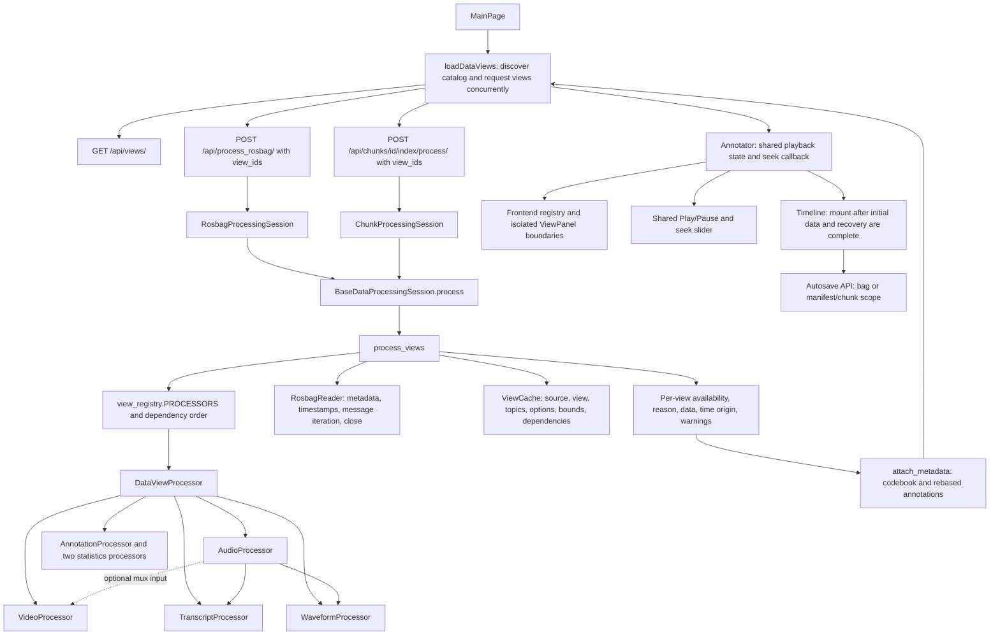

# Design diagram

This diagram describes the implemented whole-bag and chunk data-view pipeline.



```mermaid
sequenceDiagram
    participant UI as Frontend loader
    participant API as API/session
    participant Flow as Shared workflow
    participant Cache as View cache
    participant Child as Child processor
    UI->>API: Request one registered view
    API->>Flow: ProcessingRequest including bag/chunk and options
    Flow->>Flow: Inspect bag and resolve dependencies
    Flow->>Child: check_availability(context)
    alt Supported nonempty input
        Flow->>Cache: Lock and load matching cache
        alt Cache miss
            Flow->>Child: extract(context, selected_topics)
            Flow->>Child: preprocess(context, extracted)
            Flow->>Child: serialize(context, topics, data, warnings)
            Flow->>Cache: Atomically publish successful result
        end
    else Missing/invalid input or processing failure
        Flow->>Flow: Record unavailable/failed view and reason
    end
    Flow-->>API: Structured result and legacy compatibility fields
    API-->>UI: View result; other requests continue independently
    UI->>UI: Mount valid views; show per-view loading or reason
    UI->>UI: Show global error only if no usable views remain
```

The cache lock is released by the OS if a worker exits. A manifest is navigation
and recovery identity, not processing-cache identity. Optional chat context is
stored under a returned context token in Django's cache instead of module globals.
